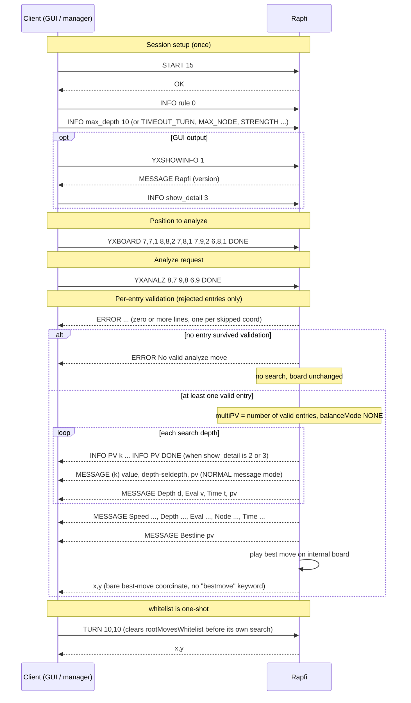

# `YXANALZ` — protocol specification

Command surface for the **YXANALZ** extension: analyze an explicit, user-supplied allow-list of
depth-0 root moves instead of the engine-generated candidate list.

- Task: [`../todo/YXANALZ-user-root-candidates.md`](../todo/YXANALZ-user-root-candidates.md)
- Execution guidance: [`../instruction/YXANALZ-user-root-candidates.md`](../instruction/YXANALZ-user-root-candidates.md)
- Handler: `Command::GomocupProtocol::analyzeMoves()` — `command/gomocup.cpp:646`
- Dispatch: `command/gomocup.cpp:926`
- Root-move wiring: `Search::generateRootMoves()` — `search/searchengine.cpp:82`
- Option field: `SearchOptions::rootMovesWhitelist` — `search/searchcommon.h:168`

---

## 1. Purpose

`YXANALZ` replaces the engine's root-move generation with an explicit list of moves supplied by
the client. Every listed move is searched as its own PV line and reported through the normal
multi-PV output path, then the highest-scoring one is returned as the best move.

| Command | Root list | Reports |
|---|---|---|
| `TURN` / `BEGIN` | engine-generated, 1 PV | best move |
| `YXNBEST n` | engine-generated, then top `n` kept | `n` PV lines + best move |
| **`YXANALZ` a,b c,d …** | **exactly the client's list, verbatim, in order** | one PV line per listed move + best move |

Semantically `YXANALZ` is the **inverse of `YXBLOCK`**: `YXBLOCK` is a deny-list of moves the
engine must not play, `YXANALZ` is an allow-list that is the *only* thing the engine may play.
Unlike the normal root path, the allow-list branch skips `MovePicker`, block-move filtering and
symmetry filtering — symmetric entries are all kept, and the input order is preserved until the
search sorts by value.

---

## 2. Syntax

```
YXANALZ <coord> <coord> <coord> ... DONE
```

- `<coord>` is a single whitespace-free token `x,y` — a comma with **no surrounding spaces**
  (`8,7` is one token; `8, 7` is two and will not parse as intended).
- `x` is the 0-indexed column, `y` the 0-indexed row, origin `(0,0)`. Orientation can be remapped
  by the `coord_conversion_mode` config key (`none` / `X_flipY` / `flipY_X`); default `none`.
- The list is terminated by the token `DONE` **or** by end-of-stream. `DONE` is case-insensitive,
  like every protocol keyword.
- Any number of coordinates may be given (subject to board space). Duplicates are allowed on the
  wire but silently collapsed.
- `-1,-1` (the protocol PASS coordinate) is **not** a legal analyze move — see §4.

The coordinate tokens are read one at a time with `std::cin >> token`, so they may be split
across as many lines as convenient, e.g.

```
YXANALZ
8,7
9,8
6,9
DONE
```

---

## 3. Protocol sequence

### 3.1 Preconditions

| Condition | If not met |
|---|---|
| A game has been started (`START` / `RECTSTART`) — an internal board exists | `ERROR No game has been started.` — command ignored |
| The engine is idle (no search in progress) | command is silently ignored by the protocol loop (`gomocup.cpp:882`); send `STOP` / `YXSTOP` first |
| The board is in the position to analyze — set beforehand with `BOARD … DONE` or `YXBOARD … DONE` | analysis runs on whatever position is current |

`YXANALZ` is in the board-modifying command group, so any active **ponder** search is stopped
before the handler runs (`gomocup.cpp:889`).

### 3.2 Ordered exchange



### 3.3 Step detail

1. **Parse loop.** For each token until `DONE` / EOF:
   1. `DONE` (case-insensitive) → stop reading.
   2. Feed the token to `parseLegalCoord` → `inputCoordConvert` → `Board::isLegal`. In-board and
      empty-cell are required. On failure: `ERROR Coord is not valid or empty.`, entry skipped.
   3. Reject `Pos::PASS` (`-1,-1`): `ERROR Analyze move can not be a pass, ignored.`, entry skipped.
   4. Reject a Renju forbidden point when Black is to move
      (`board->checkForbiddenPoint(pos)`): `ERROR Analyze move is a forbidden point, ignored.`,
      entry skipped.
   5. Drop duplicates silently.
   6. Otherwise append to the whitelist.
2. **Empty result guard.** If no entry survived: `ERROR No valid analyze move`, return to the
   protocol loop. **No search is started and the board is not modified.**
3. **Configure search.** `options.rootMovesWhitelist = <validated list>`;
   `options.balanceMode = BALANCE_NONE`; `options.multiPV = max(1, list.size())`.
4. **Search.** `think()` → `generateRootMoves()` detects the non-empty whitelist and uses it
   verbatim as the depth-0 root moves (in input order, no filtering). Iterative deepening then
   searches every root move; results are sorted best-first.
5. **Progress output.** Emitted according to the active message mode / `SHOW_DETAIL`
   (see §5). In the default plain-console mode only the final summary lines appear.
6. **Completion.** The `think()` callback calls `sendActionAndUpdateBoard()`:
   - the best move is **played on the internal board** (ply +1, side to move flips), and
   - a bare coordinate line `x,y` is printed — this is the analyze result. There is no
     `bestmove` keyword; behaviour is identical to `YXNBEST`.
7. **One-shot lifetime.** `rootMovesWhitelist` is rebuilt from scratch on every `YXANALZ` and
   cleared at the top of every other think entry point (`turn`, `begin`, `getPosition` for
   `BOARD`/`YXBOARD`, `nbest`, `balance`, `searchDefend`, `swap2board`). It never leaks into a
   later `TURN`.

### 3.4 Termination

`YXANALZ` respects the currently configured search limits exactly like `YXNBEST` — there is no
implicit infinite analysis. Set the stop condition beforehand with any of `TIMEOUT_TURN`,
`TIMEOUT_MATCH`, `TIME_LEFT`, `MAX_DEPTH`, `MAX_NODE`, `STRENGTH`. `STOP` / `YXSTOP` ends the
search early and still prints the current best move; `END` terminates the engine.

---

## 4. Validation rules

| Input | Result | Console |
|---|---|---|
| Empty cell, in board | accepted | — |
| Off-board / occupied cell | skipped | `ERROR Coord is not valid or empty.` |
| `-1,-1` (PASS) | skipped | `ERROR Analyze move can not be a pass, ignored.` |
| Renju forbidden point, Black to move | skipped | `ERROR Analyze move is a forbidden point, ignored.` |
| Coordinate repeated in the list | de-duplicated silently | — |
| List empty after validation | no search, board unchanged | `ERROR No valid analyze move` |
| A move far from all stones (outside `candidatesBB`) | accepted; `board->move()` refreshes candidates around it. Eval may be less reliable — not guarded. | — |

The whitelist branch deliberately keeps moves that the normal root path would remove:
symmetric-duplicate moves and moves also present in `YXBLOCK`'s deny-list are both retained.

---

## 5. Output format

The lines emitted during the search depend on `messageMode` (config `message_mode`, or set to
`NORMAL` by `YXSHOWINFO`) and on `SHOW_DETAIL` (`INFO show_detail <0..3>`).

### 5.1 Per-PV line (`NORMAL` / `UCILIKE` message mode, `numPv > 1`)

```
MESSAGE (k) <value> | <rootDepth>-<selDepth> | <pv>
```

`k` is 1-based and follows the current best-first ordering, so the same listed move can appear
under different `k` at different depths. Source: `SearchPrinter::printPvCompletes`
(`search/searchoutput.cpp:97`).

### 5.2 Detailed `INFO` block (`SHOW_DETAIL` ≥ 2, i.e. `INFO_DETAIL`)

One block per PV per depth:

```
INFO PV <0-based idx>
INFO NUMPV <count>
INFO DEPTH <rootDepth>
INFO SELDEPTH <selDepth>
INFO NODES <nodes for this move>
INFO TOTALNODES <nodes total>
INFO TOTALTIME <ms>
INFO SPEED <nodes/s>
INFO EVAL <value>
INFO WINRATE <0..1>
INFO BESTLINE <space-separated x,y coords>
INFO PV DONE
```

### 5.3 Final summary (always, in `NORMAL` / `BRIEF`)

```
MESSAGE Speed <s> | Depth <d>-<sd> | Eval <v> | Node <n> | Time <t>
MESSAGE Bestline <pv>
x,y
```

The trailing bare `x,y` is the analyze result and is also applied to the internal board.

### 5.4 Worked example

Position `YXBOARD 7,7,1 8,8,2 7,8,1 7,9,2 6,8,1 DONE`, then `YXANALZ 8,7 9,8 6,9 DONE`
(freestyle, shallow depth), plain console:

```
MESSAGE Speed 712K | Depth 8-9 | Eval 22 | Node 712 | Time 1ms
MESSAGE Bestline I8 I7 F10 H7 G11 J8
8,7
```

The engine picked `8,7` (internal `I8`); `9,8` scored worst (walks into a mate). The board now
has a Black stone at `8,7` and White to move. A `YXNBEST 60` on the same position shows the
same overall character. (Matches the targeted-position test
`analyzeMoves_threeMoves_reportsSanePerMoveValues`, `tests/analyzeMoves_tests.cpp:220`.)

---

## 6. Relationship to other commands

| Command | Interaction |
|---|---|
| `BOARD` / `YXBOARD` | set the position first; both clear any prior whitelist |
| `YXBLOCK` / `YXBLOCKUNDO` / `YXBLOCKRESET` | deny-list; **ignored** inside the `YXANALZ` branch (the allow-list wins) |
| `YXNBEST` | generates its own root list then reports top `n`; clears the whitelist |
| `YXBALANCEONE` / `YXBALANCETWO` | balance search; `analyzeMoves()` forces `BALANCE_NONE`, and the two are mutually exclusive (asserted in `generateRootMoves`) |
| `TURN` / `BEGIN` | normal search; clears the whitelist before generating roots |
| `INFO show_detail` / `YXSHOWINFO` | control how much progress output the analyze search prints |

---

## 7. Full session transcript

```
START 15
OK
YXSHOWINFO 1
MESSAGE Rapfi 0.43.02 ...
INFO rule 0
INFO max_depth 10
INFO show_detail 3
YXBOARD 7,7,1 8,8,2 7,8,1 7,9,2 6,8,1 DONE
YXANALZ 8,7 9,8 6,9 DONE
INFO PV 0
INFO NUMPV 3
... (INFO blocks + "MESSAGE (k) ..." lines, one set per depth) ...
MESSAGE Depth 7-9 | Eval 22 | Time 1ms | I8 I7 F10 H7 G11 J8
MESSAGE Speed 660K | Depth 7-9 | Eval 22 | Node 660 | Time 1ms
8,7
```
